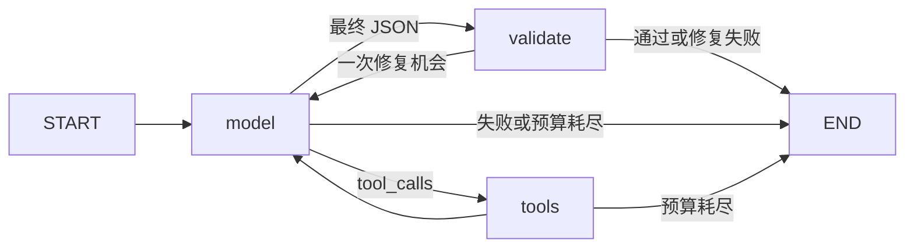

# langgraph-moderation-demo

通过教学用 Trust & Safety 内容审核学习 LangGraph：文本 → 规则与上下文 →
结论、**input evidence**、**policy citation**，必要时人工复核。

这是基于用户回忆和少量找回记录的新重建，不是原始代码恢复。范围为 Phase 0–4。

## 当前能力与边界

- 3 条带稳定 ID、条款、版本、例外和示例的教学 policy，12 个中文教学案例。
- 三工具调用、显式 LangGraph 节点、条件路由、预算、强制结果校验。
- SQLite checkpoint、历史、thread 隔离、暂停和跨进程恢复。
- 独立的 draft → revise reducer 复习实验。
- scripted 离线回放；local 连接支持工具调用的 OpenAI-compatible 模型服务。

**scripted 回放人工参考答案，不调用语言模型，不能评估判断质量。**
云端验证编排及 SDK 协议；WSL 的真实 Qwen、显存、量化和工具调用表现尚未验证。
完成本地模型验证后，才把端到端 baseline 视为已恢复并开始 Phase 5。

Policy 不是任何平台的真实完整规则；案例与电话号码为教学虚构数据。
人工参考答案供演示，不是独立评估集。

## 在 WSL 安装并运行

在已 clone 的实际仓库根目录执行，不另建 checkout/worktree。
Windows App 与 WSL 应打开同一 checkout；云端副本通过 Git 同步。
推荐 Python 3.12 和 [uv](https://docs.astral.sh/uv/getting-started/installation/)。
尚未安装 uv 时，可使用官方安装器，然后按提示刷新终端：

```bash
curl -LsSf https://astral.sh/uv/install.sh | sh
```

确认 uv --version 可用后：

```bash
uv sync --frozen --all-groups
uv run --frozen moderation-demo cases
uv run --frozen moderation-demo run --backend scripted --case threat-direct
```

uv.lock 固定依赖解析；.python-version 推荐 3.12。节点更新到 stderr，最终 JSON 到 stdout。
输出 backend.kind 明确标记 scripted/local。默认 thread ID 每次不同。
数据库在 .local/checkpoints.sqlite，不提交 Git；再次 run 同一 thread 会拒绝覆盖。

## 业务结果与执行状态

| 字段 | 含义 |
| --- | --- |
| decision | ALLOW / VIOLATION / NEEDS_REVIEW |
| input_evidence[].quote | 逐字来自提交的 text，不能用 context 代替 |
| policy_citations[] | policy_id、section_id、version、逐字 quote |
| rationale | 简短理由 |
| review_reason | 人工复核的具体原因；其他决定为 null |

VIOLATION 必须有文本证据和规则引用。ALLOW 只表示选定规则范围内未发现违规。
NEEDS_REVIEW 用于信息不足或规则适用歧义。服务错误、预算耗尽或修复失败使用
status=failed、result=null，进程返回非零。

Catalog.check_result 强制检查原文证据、条款存在性、版本、规则/例外逐字引用。
**真实条款是否在语义上支持结论，仍需人工判断和后续 evaluation。**

## Graph 与工具



| 新设计工具 | 作用 |
| --- | --- |
| search_policies(query) | 关键词/字符重叠搜索，返回 ID、版本、source 和原始计数分数 |
| get_policy(policy_id, version) | 指定版本的完整条款、例外、示例 |
| get_case_context(requested_case_id) | 仅当前案例；无上下文明确返回 available=false |

程序执行工具并产生匹配 tool_call_id 的 ToolMessage，再让模型继续。
check_result 是程序必经步骤，不是可选的第四个模型工具。
当前完整 policy 仍在 system prompt 中，搜索没有引入 embedding/向量库。

State 中 messages 使用 add_messages；result 是独立业务输出；status 表示执行状态。
model_calls、tool_calls、repair_attempts、errors 用于观察。节点返回部分更新。
默认最多 6 次后端调用、8 次工具执行、1 次格式/引用修复。
scripted 中 model_calls 是模拟后端调用次数，不是真实 LLM API 请求数。

## Checkpoint：退出进程再恢复

首次使用新 thread ID：

```bash
uv run --frozen moderation-demo run --backend scripted --case threat-direct --thread checkpoint-1 --pause-before validate
uv run --frozen moderation-demo history --thread checkpoint-1
uv run --frozen moderation-demo resume --thread checkpoint-1
uv run --frozen moderation-demo history --thread checkpoint-1 --messages
```

首次在校验前暂停并退出，paused=true、next=["validate"]、result=null。
resume 从同一 SQLite/thread 继续校验，不重新请求模型。
已结束的 thread 不能再次 resume；查看 history 或用新 thread。
自定义数据库时，每条命令传入相同 --db 路径。

在同一数据库中另用一个 thread 运行 privacy-unclear，分别查看历史，验证隔离。
恢复需要同一代码、policy 版本及数据库。本轮不演示 time travel/历史分叉。
工具均为只读，不演示有副作用工具的 exactly-once 保证。

简短 reducer 复习：

```bash
uv run --frozen moderation-demo lab
```

独立 draft → revise 的历史会显示：同一 answer-1 更新消息，result 覆盖，
省略的 model_calls 保留，draft 状态仍在历史中。它不是审核 agent，也不调用模型。

## WSL 本地 Qwen：待本机验证

先检查 WSL GPU、可用显存、已有模型服务和模型列表，再选运行方案。
Qwen3.5 9B 量化版本是候选，权重、工具 parser、chat template、thinking 和上下文预算待核实。
本项目不自动安装推理服务或下载模型，不假定旧项目用过 Ollama 或 llama.cpp。

显式设置实际的 OpenAI-compatible 地址和模型名；下方端口只是示例：

```bash
export MODERATION_BASE_URL="http://127.0.0.1:11434/v1"
export MODERATION_MODEL="替换成服务实际加载的模型名称"
uv run --frozen moderation-demo run --backend local --case threat-direct
```

模型接入后也可提交自己的文本和上下文，无需人工参考答案：

```bash
uv run --frozen moderation-demo run --backend local --text "待审核文本" --context "可选的已知上下文"
```

自定义输入只能使用 local；scripted 不会假装对新文本作出判断。

服务需要支持 /chat/completions 和 OpenAI 格式的 tools。
无认证本地服务使用非秘密占位 key。若实际服务需要认证，安全配置 MODERATION_API_KEY，
不提交值、不把凭据放进 URL。key 不保存到 checkpoint；resume 从当前进程读取认证，
使用保存的模型名和 URL。

Adapter 采用 JSON schema 提示 + Pydantic 校验，不假设服务支持强约束 JSON 解码。
先验证基础生成、JSON、一次工具调用，再运行正常、违规、边界和对抗案例。
Prompt 规定待审核文本是数据，但尚未证明真实模型具有抗注入能力。

## 验证与接续

```bash
uv run --frozen ruff check .
uv run --frozen ruff format --check .
uv run --frozen pytest -q
```

测试覆盖工具协议、坏引用、预算与修复、独立进程恢复、thread 隔离；
真实 ChatOpenAI SDK 连接本地 HTTP stub 测试工具请求和 ToolMessage。
这些测试不需要 GPU/模型 API，不代表真实 Qwen 已通过。

- [roadmap.md](roadmap.md)：阶段目标、最小实验、验收。
- [learning-progress.md](learning-progress.md)：历史来源、当前证据、未测试项和下一步。
- [AGENTS.md](AGENTS.md)：跨 session 协作约定。
